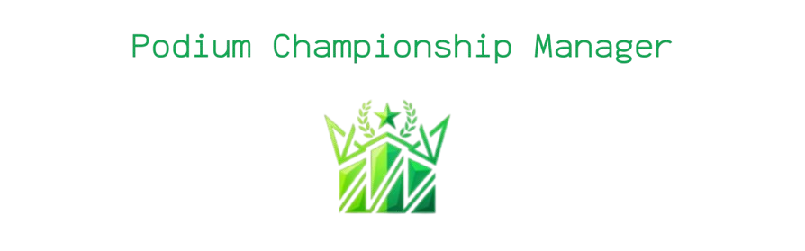

# 🏆 Podium Championship Manager
O Podium é uma plataforma completa para gerenciamento de campeonatos e times de diferentes modalidades esportivas. Com uma interface simples, interativa e focada na experiência do usuário.


## 🎯 Sobre o Projeto
O Podium nasceu com o objetivo de se tornar a maior gerenciadora de campeonatos amadores e semiprofissionais. Sabemos que organizar torneios de futebol, vôlei, basquete ou e-sports é uma tarefa complexa. Por isso, o Podium centraliza a criação de campeonatos, gestão de elencos e lançamento de pontuações (com suporte a diferentes regras, como sets e tempos) em um único lugar.

## ⚙️ Funcionalidades
### ✅ Implementadas (Backend & Regras de Negócio)
Autenticação de Usuários: Cadastro e Login seguros com criptografia de senha (BCrypt).

Gestão de Campeonatos: Criação de campeonatos com modalidades, datas e regras de administração (criador tem permissões de dono).

Gestão de Times: Criação de times e gerenciamento de múltiplos administradores por equipe.

Gestão de Atletas: Cadastro de atletas e vinculação (contratação/transferência) aos times.

Controle de Acesso: Apenas administradores do time ou do campeonato podem editar informações e lançar placares.

Sistema Flexível de Pontuação: Uso de dados JSONB no banco para registrar placares de esportes diferentes (ex: gols no futebol, sets no vôlei, quartos no basquete) sem engessar o banco de dados.

API RESTful: Endpoints completos para integração com o aplicativo mobile.

### 🚧 Em Desenvolvimento (Frontend/Android)

[ ] Criação das telas de Login e Cadastro no aplicativo Android.

[ ] Integração do Android com a API via Retrofit.

[ ] Tela de visualização de tabelas de classificação e chaveamento de jogos.

[ ] Dashboard para o administrador gerenciar o campeonato pelo celular.

[ ] Implementação de notificações para jogos e resultados.

## 🛠️ Tecnologias Utilizadas

### 💻 BackEnd
Java 21 (ou a versão que você configurou no final)

Spring Boot: Framework principal para a construção da API REST.

Spring Data JPA / Hibernate: Mapeamento objeto-relacional e persistência de dados.

Spring Security (Crypto): Para a criptografia de senhas utilizando BCryptPasswordEncoder.

PostgreSQL (via Supabase): Banco de dados relacional hospedado na nuvem.

JSONB: Utilizado no PostgreSQL para armazenar os detalhes flexíveis de pontuação.

AWS EC2: Infraestrutura em nuvem para hospedar a API (instância t2.micro).

Maven: Gerenciamento de dependências e build do projeto.

### 📱 FrontEnd (Mobile)

Kotlin: Linguagem principal para o desenvolvimento Android.

Android Studio: IDE de desenvolvimento.

Retrofit & Gson: Para consumo da API REST e conversão de JSON para objetos Kotlin.

Material Design 3: Para a criação de uma interface moderna e intuitiva.

## 🚀 Como executar o projeto localmente

### Pré-requisitos
Java 21+

Maven

Um banco de dados PostgreSQL (ou conta no Supabase).

### Passo a passo

1. Clone este repositório:
```bash
git clone https://github.com/seu-usuario/Podium.git
```
2. Navegue até a pasta do backend:
```bash
cd Podium/BackEnd/demo
```

3. Configure o arquivo src/main/resources/application.properties com as credenciais do seu banco (URL, usuário e senha).

4. Rode a aplicação:
```bash
mvn spring-boot:run
```

5. A API estará disponível em http://localhost:8080/api/.

Projeto desenvolvido para fins de estudo e evolução no ecossistema Java/Android.
